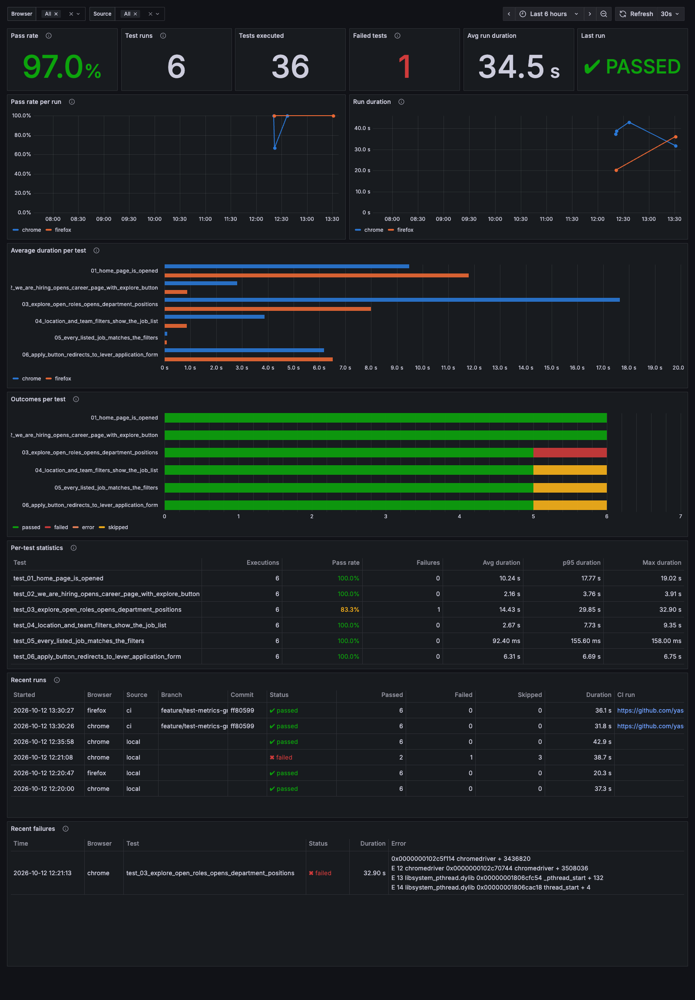

# Insider One — Career Flow UI Automation

Python + Selenium + pytest test automation for the Insider One career scenario,
organised with the Page Object Model. No BDD framework is used.

## Scenario coverage

| # | Test | Step |
|---|------|------|
| 1 | `test_01_home_page_is_opened` | Visit insiderone.com and verify the Insider One home page |
| 2 | `test_02_we_are_hiring_opens_career_page_with_explore_button` | Click "We're hiring", verify the Career page and the "Explore open roles" button |
| 3 | `test_03_explore_open_roles_opens_department_positions` | Click "Explore open roles", then "xx Open Positions" in the department block |
| 4 | `test_04_location_and_team_filters_show_the_job_list` | Filter Location = Istanbul, Turkiye and Team = Customer Success, verify the job list |
| 5 | `test_05_every_listed_job_matches_the_filters` | Every listed job's position and location must match the filters |
| 6 | `test_06_apply_button_redirects_to_lever_application_form` | Apply must redirect to the Lever application form |

## Requirements

- Python 3.10+
- Google Chrome and/or Firefox installed

Driver binaries are resolved automatically by Selenium Manager — no manual
chromedriver/geckodriver setup is needed.

## Setup

```bash
python3 -m venv .venv
source .venv/bin/activate
pip install -r requirements.txt
```

## Running

```bash
pytest                                  # default browser (chrome)
pytest --browser=chrome
pytest --browser=firefox
pytest --browser=firefox --headless
pytest tests/test_insider_careers.py::TestInsiderOneCareerFlow::test_04_location_and_team_filters_show_the_job_list
pytest --html=reports/report.html --self-contained-html   # optional HTML report
```

The whole class shares one browser session and is marked `incremental`: once a
step fails, the remaining steps are skipped instead of producing follow-up noise.

### Configuration

Everything in `config/settings.py` can be overridden with environment variables:

| Variable | Default | Purpose |
|----------|---------|---------|
| `BROWSER` | `chrome` | Default browser when `--browser` is omitted |
| `HEADLESS` | `false` | Headless mode |
| `BASE_URL` | `https://useinsider.com/` | Application under test |
| `DEPARTMENT_BLOCK` | `Software Development` | Career page block to open |
| `FILTER_LOCATION` | `Istanbul, Turkiye` | Location filter value |
| `FILTER_TEAM` | `Customer Success` | Team filter value |
| `EXPLICIT_WAIT` | `20` | Explicit wait in seconds |

Example:

```bash
FILTER_TEAM="Sales" pytest --browser=firefox --headless
```

## Failure screenshots

A PNG is captured automatically for every failing test and written to
`reports/screenshots/<test_name>_<timestamp>.png`. The path is also attached to
the pytest report output.

## Project layout

```
config/settings.py              URLs, test data, timeouts (env-overridable)
utils/driver_factory.py         Chrome/Firefox driver creation
utils/screenshot.py             Failure screenshot helper
utils/logger.py                 Step logging
utils/xpath.py                  Safe XPath string literals
pages/base_page.py              Waits, safe clicks, tab handling
pages/home_page.py              Insider One home page
pages/careers_page.py           Career page + department cards
pages/open_positions_page.py    Lever job board: filters, job list, Apply
pages/lever_application_page.py Lever application form
tests/test_insider_careers.py   The six scenario steps
utils/results_recorder.py       Writes per-test results to reports/results.json
unit_tests/                     Unit tests for the recorder and publisher (`pytest unit_tests`)
conftest.py                     Browser fixture, screenshots, incremental steps, results recorder
scripts/publish_results.py      Loads results.json into PostgreSQL
db/schema.sql                   test_runs / test_results tables
docker-compose.yml              PostgreSQL + Grafana for the metrics dashboard
grafana/                        Provisioned datasource and dashboard
.github/workflows/ui-tests.yml  CI pipeline: run tests, log results to the database
```

## Test metrics: PostgreSQL + Grafana

Every pytest session writes `reports/results.json`: one entry per test with its
status (`passed`, `failed`, `error`, `skipped`), duration, error message and
timestamps, plus run metadata (browser, branch, commit, CI run link).
`scripts/publish_results.py` loads that file into PostgreSQL, and Grafana reads
the database to visualise pass rates and execution times.

### Database schema

| Table | One row per | Main columns |
|-------|-------------|--------------|
| `test_runs` | pytest session | `browser`, `source` (`ci`/`local`), `branch`, `commit_sha`, `ci_run_url`, `started_at`, `duration_seconds`, `total`/`passed`/`failed`/`errors`/`skipped`, `status` |
| `test_results` | test in a session | `run_id`, `name`, `status`, `duration_seconds`, `error_message`, `started_at` |

Publishing is idempotent: each run carries a `run_uuid`, so loading the same file
twice stores it once.

A run's `status` is `failed` when any test failed or errored, `error` when pytest
exited abnormally or executed no test (collection error, wrong path, interrupt),
and `passed` otherwise. `pytest --collect-only` writes no results file.

### CI/CD pipeline

`.github/workflows/ui-tests.yml` runs on every push to `main`, on pull requests
and on demand. For each browser in the matrix (Chrome, Firefox) it:

1. starts a PostgreSQL service container,
2. runs the unit tests of the metrics pipeline (`unit_tests/`),
3. runs the UI suite headless,
4. **logs the results to the database** (`if: always()`, so failing runs are
   recorded too) and prints the stored rows in the job log,
5. uploads `results.json`, the HTML and JUnit reports and failure screenshots
   as the `ui-test-results-<browser>` artifact.

The CI database lives only for the duration of the job. To see CI runs in the
local Grafana, download the artifacts and publish them:

```bash
gh run download <run-id> --dir ci-results
python scripts/publish_results.py ci-results/*/results.json
```

### Running Grafana locally

Requires Docker.

```bash
docker compose up -d                     # PostgreSQL on :5432, Grafana on :3000
pytest --browser=chrome --headless       # writes reports/results.json
python scripts/publish_results.py        # loads it into PostgreSQL
```

Open http://localhost:3000 (login `admin` / `admin`). The **UI Test Metrics**
dashboard opens as the home page; the datasource and dashboard are provisioned
from `grafana/`, so nothing has to be configured by hand.



The screenshot shows four local runs (including one deliberate failure) and the
Chrome and Firefox runs of the GitHub Actions pipeline, imported from their
artifacts with `scripts/publish_results.py`. The CI rows carry the branch, commit
and a link to the workflow run.

| Panel | Shows |
|-------|-------|
| Pass rate | passed / (passed + failed + error) in the selected time range |
| Test runs, Tests executed, Failed tests | volume and failure counts |
| Avg run duration, Last run | session duration and the latest run's status |
| Pass rate per run, Run duration | trends over time, one line per browser |
| Average duration per test | execution time of each step, per browser |
| Outcomes per test | passed / failed / error / skipped count of each step |
| Per-test statistics | executions, pass rate, average / p95 / max duration |
| Recent runs, Recent failures | latest sessions (with CI links) and failure messages |

The **Browser** and **Source** filters at the top apply to every panel.

`DATABASE_URL` overrides the connection string (default
`postgresql://qa:qa@localhost:5432/test_metrics`); `POSTGRES_*` and
`GRAFANA_ADMIN_*` override the compose credentials. `docker compose down -v`
removes the containers and their data.

## Locator strategy

IDs and `data-qa` attributes are preferred, then scoped CSS selectors; XPath is
used only where a locator has to match on text (`We're hiring`,
`Explore open roles`, filter option labels). Values injected into XPath go
through `utils.xpath.xpath_literal` so quotes cannot break the expression.

Two site behaviours the page objects handle explicitly:

- The Career page ships the department card links as `href="#"` and rewrites them
  only after the Lever API responds, so `CareersPage.wait_for_open_positions_link`
  waits on the raw DOM attribute (`get_attribute` would resolve `#` to an absolute
  URL and hide the placeholder).
- The job board re-renders on every filter selection, so
  `OpenPositionsPage._open_filter_dropdown` retries while the click handlers are
  still being bound.

## Test data choice

The scenario was originally written around the Software Development block and the
Quality Assurance team. The current Insider One job board
(`jobs.lever.co/insiderone`) publishes **no Quality Assurance and no Software
Development postings**, so the Team filter does not offer a "Quality Assurance"
option at all and those steps cannot pass against live data:

```
FilterOptionNotAvailableError: The Team filter does not offer 'Quality Assurance'.
Available options: ['Business Development', 'Customer Success', ...]
```

The Team filter therefore defaults to **Customer Success**, which has 4 postings in
Istanbul, Turkiye. `DEPARTMENT_BLOCK` stays on Software Development: its card sits
in the always-visible part of the grid and, having no open roles, links to the
unfiltered board — exactly the starting point the Location/Team filters need. The
cards for the remaining departments (including Customer Success and Quality
Assurance) are hidden behind a "See all teams" toggle, so pointing
`DEPARTMENT_BLOCK` at one of them adds a dependency on that toggle for no benefit.

Nothing in the page objects or the tests is tied to these values — they are data,
not logic. Should Quality Assurance roles be published again, the original scenario
runs unchanged with:

```bash
FILTER_TEAM="Quality Assurance" pytest
```

Teams that currently have Istanbul, Turkiye postings: Customer Success (4),
Sales (3), Finance & Business Support (1), Product Management (1).
